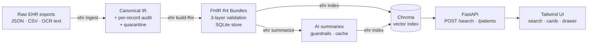

# EHR Media Intelligence Platform

An end-to-end pipeline that turns messy, heterogeneous EHR exports into **clean data → HL7 FHIR R4
bundles → AI-generated clinical summaries → a semantic search API and a clinician-facing web UI**.

> **All data is synthetic** (fictional people, generated by a seeded script). Summaries are
> AI-generated and are **not clinical decisions**. This is a demonstration, not a medical device.



## Quick start

Requirements: **Python 3.11+** (developed on 3.14) and git. Node is only needed if you change the
UI's styles (the compiled CSS is committed).

```powershell
python -m venv .venv
.\.venv\Scripts\Activate.ps1          # macOS/Linux: source .venv/bin/activate
pip install -r requirements.txt       # installs the package + dev tools (pyproject.toml is the source of truth)

ehr run-all                           # generate data -> ingest -> FHIR -> summarise -> index
ehr serve                             # http://127.0.0.1:8000   (interactive API docs: /docs)
```

* The first run downloads the `all-MiniLM-L6-v2` embedding model (~90 MB, `ehr download-models`
  does it explicitly). After that everything works offline.
* **No API key? It still works.** Without `ANTHROPIC_API_KEY`, summaries come from a deterministic
  *offline extractive baseline*, labelled as such everywhere (API, UI, stored metadata). To use
  Claude: `cp .env.example .env`, set `ANTHROPIC_API_KEY`, then `ehr summarize --force`.
* Try it: open the UI and search *"chest x-ray pneumonia"*, *"high potassium kidney disease"*,
  *"wrist fracture after a fall"*; filter by record type and date; open a patient.

### Commands

| Command | What it does |
|---|---|
| `ehr generate-data` | Create the messy synthetic inputs + `DEFECT_MANIFEST.json` (ground truth for tests) |
| `ehr ingest` | **Task 1** – clean/normalise → `clean_records.jsonl`, per-record `audit_log.jsonl`, `quarantine.jsonl` |
| `ehr build-fhir [--strict]` | **Task 2** – map to FHIR R4, validate, write `validation_report.{md,json}`, store in SQLite |
| `ehr validate [--bundle f.json]` | Re-validate stored bundles, or any single Bundle file |
| `ehr summarize [--limit N] [--force] [--provider fake\|anthropic]` | **Task 3** – summaries, cached by patient + record hash + prompt version + model |
| `ehr eval-summaries` | Score stored summaries (word limit, disclaimer, grounding, recall) |
| `ehr index` | **Task 4** – embed documents + summaries into Chroma (incremental) |
| `ehr serve [--port] [--reload]` | **Task 4/5** – API + web UI |
| `ehr run-all` | Everything above in order |

Outputs go to `data/runtime/` (git-ignored). Every stage is **idempotent**: deterministic IDs and
content hashes mean re-running changes nothing unless the inputs changed.

### Configuration (`EHR_*` environment variables or `.env`)

| Variable | Default | Purpose |
|---|---|---|
| `ANTHROPIC_API_KEY` | – | Enables Claude summaries |
| `EHR_LLM_PROVIDER` | `auto` | `auto` (Anthropic only if a key exists), `anthropic`, `fake` |
| `EHR_LLM_MODEL` | `claude-haiku-5-5` | Model for summaries |
| `EHR_LLM_MAX_TOKENS` / `EHR_LLM_TIMEOUT_S` | `4096` / `60` | Thinking tokens count toward `max_tokens`, so keep headroom |
| `EHR_EMBEDDING_BACKEND` | `sentence-transformers` | or `hashing` (instant, non-semantic; for tests/offline) |
| `EHR_EMBEDDING_MODEL` | `sentence-transformers/all-MiniLM-L6-v2` | Any sentence-transformers model id |
| `EHR_SEARCH_TOP_K` | `5` | Results per query |
| `EHR_DATA_DIR`, `EHR_RAW_DIR`, `EHR_FRONTEND_DIR` | `data/runtime`, `data/sample/raw`, `frontend/public` | Paths |

## API

```bash
curl -X POST "http://127.0.0.1:8000/search?resource_type=DiagnosticReport&date_from=2024-06-01&date_to=2024-12-31" \
     -H "Content-Type: application/json" -d '{"query": "chest x-ray pneumonia"}'
```

| Endpoint | Purpose |
|---|---|
| `POST /search` | Body `{"query": "..."}` (1–500 chars). Query params: `resource_type` (`DocumentReference` \| `DiagnosticReport` \| `Patient` = AI summaries), `date_from`, `date_to`. Returns the **top 5** distinct records with cosine relevance `score`, patient name/MRN, record date, snippets and `took_ms`. 422 on invalid input (incl. `date_from > date_to`). |
| `GET /patients/{id}` | Demographics, full AI summary (+ disclaimer, confidence, provenance), linked FHIR resources |
| `GET /patients/{id}/bundle[?download=true]` | The patient's Bundle as `application/fhir+json` |
| `GET /patients/{id}/resources/{rid}` | One FHIR resource (loaded lazily by the UI) |
| `GET /meta/resource-types`, `GET /health` | Filter options; liveness + counts |

There is **no authentication** (synthetic demo data). A real deployment needs SSO/OAuth, audit
logging and TLS before any PHI touches it.

## Design decisions and trade-offs

| Decision | Why | Cost / limit |
|---|---|---|
| **`fhir.resources.R4B`**, not R4 | The Pydantic-v2 line (8.x) ships R5, R4B and STU3 – there is *no pure R4*. R4B (4.3.0) is wire-compatible for all five resources used. The only pure-R4 line (6.x) needs Pydantic v1, which the stack excludes. | Technically FHIR 4.3.0, not 4.0.1 |
| **3-layer validation** (schema → reference integrity → profile rules) | `fhir.resources` checks *structure* only – it happily accepted `gender="banana"`. Layers 2–3 add in-bundle reference resolution, required value-set bindings, required elements, attachment integrity, code-system whitelist. | No FHIRPath invariants or terminology-server checks (HL7 validator is the next step) |
| **Quarantine on MRN conflict, never merge** | One MRN used by two *different* people (different DOB/name) is a patient-safety issue; all its records go to quarantine for human review. Same name+DOB under two MRNs is *flagged*, not merged. | Those patients are absent until reviewed |
| **Anomalies are computed, not requested** | Abnormal labs and data-quality tags are detected deterministically, handed to the model, and a guardrail re-adds any it drops | More code than a prompt alone |
| **Guardrails around the LLM** | Hard ≤200-word limit (prompt targets 150 → one retry → deterministic trim), grounding check (dates / ICD-10 / numbers must exist in the source), disclaimer & provenance set by code | Grounding is a tripwire for invented facts, not proof of clinical correctness |
| **PHI minimisation** | The model sees age + sex – never name, MRN or exact DOB; record text is wrapped as untrusted data (prompt-injection hardening) | Dates of service are still sent |
| **Chroma** over FAISS | Native metadata filtering for resource type + date range. Range filters are numeric-only, so dates are stored as `YYYYMMDD` ints | – |
| **Summary vectors tagged `Patient`**, dated by latest record | The resource-type and date filters then apply uniformly to records *and* summaries; imaging `DocumentReference` + `DiagnosticReport` collapse into one hit | – |
| **Vanilla JS + committed Tailwind CSS** | No framework or Node needed to run; native `<dialog>` gives focus trap, Esc and inert background | Hand-rolled rendering code |
| **stdlib `sqlite3`**, repositories, versioned migrations | ~5 tables, no ORM weight; parameterised SQL; WAL | – |
| **Offline summariser** | Whole app and test-suite run with no key or network | It is extractive, not "AI" – hence the explicit label |

### Data-quality handling (Task 1)

Every change is written to a per-record audit log (`field`, `rule`, `before` → `after`, severity);
nothing is silently dropped – rejects go to `quarantine.jsonl` with a reason.

| Problem | Handling |
|---|---|
| Mixed date formats (`2025-03-02`, `03/02/2025`, `3/2/25`, `02-Mar-2025`, `March 2, 2025`, `20250302`) | Parsed deterministically; month-first for ambiguous numeric dates **and flagged** (`AMBIGUOUS_DATE`); 2-digit years never land in the future |
| MRN formats (`MRN-00012345`, `12345`, `#00012345`, OCR `0O012345`) | Canonical 8-digit; OCR confusions corrected and audited |
| Gender codes (`M`, `1`, `Female`, `N/A`) | Mapped to FHIR administrative-gender; unmapped → `unknown` + flag (never guessed) |
| Missing fields | Imputed *only* from evidence (document date from its encounter, audited); otherwise quarantined or kept with a flag (`DOB_MISSING`) |
| Implausible DOB (future / >120 y) | Field discarded + audited |
| Exact and near duplicates (export vs OCR re-scan) | Collapsed (structured source wins); similarity ≥ 0.95; audited |
| Conflicting identifiers | See *quarantine on MRN conflict* above |
| Lab names/units/flags | Alias-mapped; value-preserving unit normalisation; missing H/L flags derived from the reference range |

On the bundled sample: 968 raw records from 83 files → 60 patients, 180 documents, 325 lab results,
118 encounters; 51 records quarantined (48 filed under the 2 conflicting MRNs, plus 3 unusable
documents); 2,633 audit entries.
The generator seeds 35 known defects and a test asserts **every one is detected**.

### FHIR mapping (Task 2)

| IR | FHIR resource | Notes |
|---|---|---|
| Patient | `Patient` | MRN identifier (`v2-0203` type `MR`), name, gender, birthDate; ingestion flags as `meta.tag` |
| Encounter | `Encounter` | `class` from v3-ActCode; stubs synthesised (and tagged) when a source only cites an id |
| Document | `DocumentReference` | LOINC type, `context.encounter`, base64 attachment with `size` + SHA-1 |
| Imaging / lab panels | `DiagnosticReport` | Category `RAD` / `LAB`, `result[]` → Observations, `conclusion`, `presentedForm` |
| Lab result | `Observation` | LOINC (checked against the NLM registry; unmapped = text-only, never invented), UCUM units, reference range, interpretation |

One `collection` Bundle per patient. Resource ids are deterministic UUIDv5; `fullUrl` and references
use `urn:uuid:` so they resolve inside the Bundle. Sample result: **60/60 bundles valid, 847
resources, 0 errors**, 4 warnings (patients with no DOB).

## Testing

```bash
pytest                          # 354 tests, ~80 s, no network, no API key
pytest --cov=ehr_media          # 95 % line+branch coverage
pytest -m "slow or perf" -s     # 12 more: real embedding model – relevance + latency
pytest -m live -s               # real Claude API (needs ANTHROPIC_API_KEY)
ruff check . && ruff format --check . && mypy      # lint + strict type-check
cd frontend && npm ci && npm test                  # 28 front-end unit tests (node:test)
cd frontend && npm run build:css                   # only after changing Tailwind classes
```

What was verified, and how – including what was **not**:

| Claim | Evidence |
|---|---|
| Ingestion detects every seeded defect | Test compares the audit log against `DEFECT_MANIFEST.json` |
| FHIR errors are surfaced precisely | Negative tests corrupt a Bundle and assert the exact JSON path in the report |
| Search < 2 s over ≥ 50 records | Real model, 60 patients / 404 index entries, 32 queries over HTTP: **median 84 ms, p95 109 ms, max 137 ms** |
| Search is semantically useful | 8 paraphrased clinical queries (e.g. *"swollen legs and trouble breathing when lying flat"*) all retrieve the right records |
| UI is accessible and responsive | axe-core in a real browser: **0 violations** (WCAG 2.x A/AA + best practice) in the initial, results and drawer states; phone-width layout; keyboard-only flow; error + recovery |
| Summary guardrails work | Unit tests: over-length → retry then trim, dropped anomaly restored, invented/rounded values caught, cache hit = 0 LLM calls |
| Offline-baseline summaries meet the hard requirements | `ehr eval-summaries` over 60 patients: 100 % ≤ 200 words, 100 % disclaimer, 100 % grounded |
| **Claude summaries** | **Not scored here** – no API key was available while building. The Anthropic adapter is unit-tested against a stubbed SDK; run `pytest -m live` and apply `docs/summary_review_rubric.md` to evaluate real output |

## Project layout

```
src/ehr_media/
  ingestion/      readers/ (json, csv, text) · normalizers/ · builders · reconcile · dedupe · linking · pipeline
  fhir/           mappers · builder · validation (3 layers) · report · terminology · ids
  storage/        db (migrations) · bundle_repo · summary_cache
  summarization/  context · anomalies · prompts · llm (Anthropic + offline) · guardrails · service · evaluation
  search/         chunking · embedder · vector_store (Chroma) · indexer · service
  api/            app factory · routes (search, patients, health) · schemas
  synthetic/      seeded generator + clinical archetypes
  cli.py          `ehr` command
frontend/         public/ (index.html, js/, dist/app.css – served) · src/input.css · tests/ (node:test)
data/sample/      synthetic raw inputs + DEFECT_MANIFEST.json
tests/            unit/ · integration/ · eval/ (slow, perf, live)
docs/             WRITEUP.md/.pdf · summary_review_rubric.md
```

## Requirement coverage

| Brief | Where |
|---|---|
| T1 ≥2 formats (JSON + plain-text/CSV) | JSON export, lab CSV **and** OCR-style `.txt` notes |
| T1 missing fields, dates, duplicates, conflicting IDs | `ingestion/` – see the table above |
| T1 canonical demographics + Pydantic IR + per-record audit | `ingestion/models.py`, `audit.py`; `audit_log.jsonl` |
| T1 ≥3 edge-case tests | `tests/unit/ingestion/` (~140 tests) |
| T2 Patient, DocumentReference, DiagnosticReport (+ Encounter, Observation) | `fhir/mappers.py` |
| T2 `fhir.resources` validation; Bundles with subject/encounter refs; clear error report | `fhir/validation.py`, `report.py` → `validation_report.md` |
| T2 local SQLite store | `storage/bundle_repo.py` |
| T3 LLM summaries: concern, diagnoses, recent media, anomalies | `summarization/` |
| T3 < 200 words; cache by patient + record hash; disclaimer/confidence | `guardrails.py`; `summary_cache.py`; `ClinicalSummary.disclaimer/confidence` |
| T4 embeddings + vector store; `POST /search` top-5 with scores; type/date filters; < 2 s | `search/`, `api/routes/search.py` |
| T5 search bar, cards, drawer, filters, loading/empty states, ARIA, keyboard, responsive | `frontend/public/` |
| Stack: Python 3.11+, FastAPI, Pydantic v2, fhir.resources, sentence-transformers, Chroma, SQLite, pytest, Tailwind, Fetch API | `pyproject.toml`, `frontend/` |

## Limitations

* Synthetic data only; OCR is simulated (text files), not real scans.
* FHIR validation is structural + custom rules, not full HL7 conformance.
* No authentication, audit trail of *access*, encryption at rest or consent model – required before any real PHI.
* Clinical text is sent to the LLM provider when Claude is enabled; real deployments need a BAA / zero-retention terms.
* The quarantine is a file, not a review workflow.
